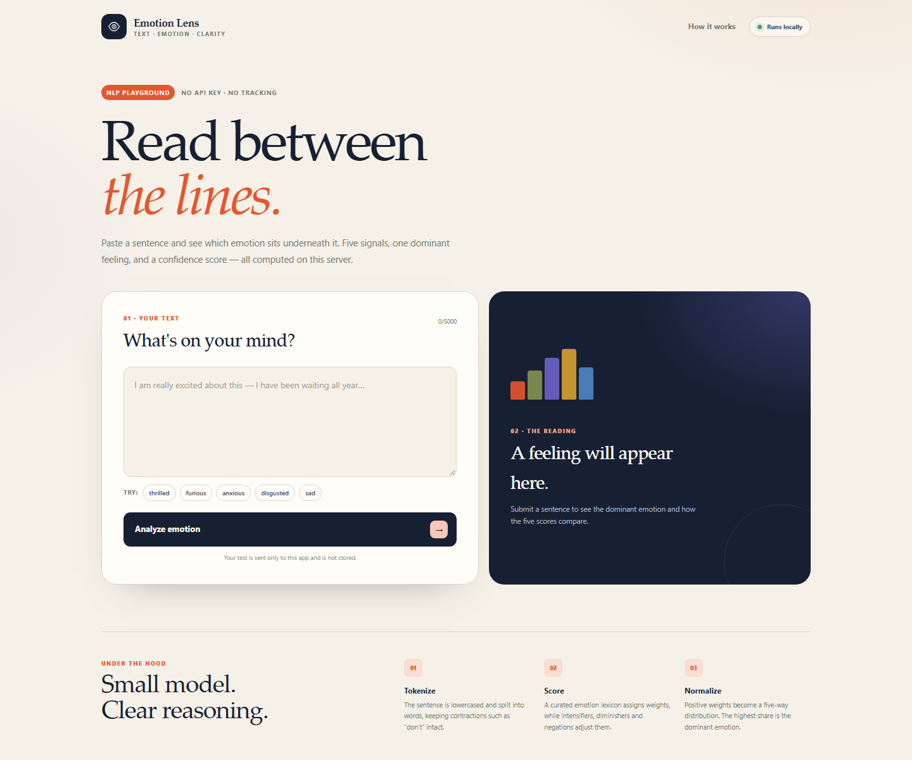
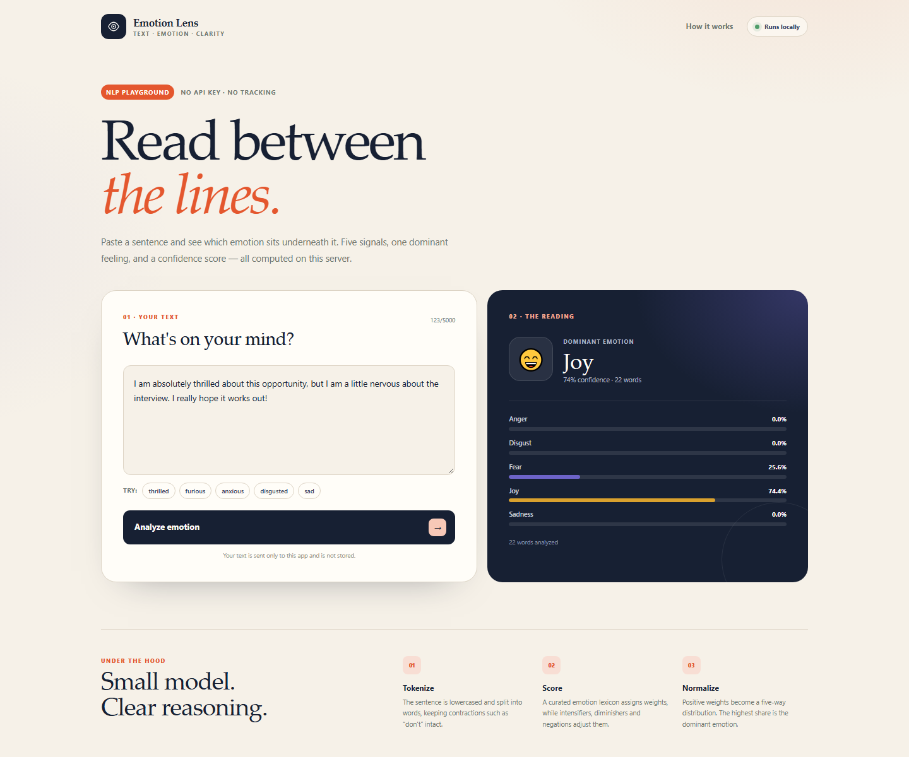
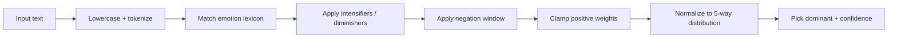

<div align="center">

# 🎭 Emotion Lens

**Paste a sentence. See the feeling underneath it.**

A tiny Flask + vanilla JavaScript emotion detector with five emotion scores, a dominant
emotion, and a confidence reading — running entirely on your own server.

[](https://www.python.org/)
[](https://flask.palletsprojects.com/)
[](#-why-offline)
[](#-testing)
[](LICENSE)

[**Try the code**](https://github.com/BennyLinntu/it) ·
[**Report a bug**](https://github.com/BennyLinntu/it/issues)

</div>

---

## 🖼️ Preview

<div align="center">
  
  <p><em>A clean workspace for a single sentence or a whole paragraph.</em></p>
</div>

<div align="center">
  
  <p><em>Dominant emotion, confidence, and the five underlying scores.</em></p>
</div>

---

## ✨ Why offline?

The original capstone project called a hosted Watson NLP endpoint. That endpoint is no
longer dependable, so this rewrite replaces it with a **local, explainable lexicon model**:

- 🔌 no network dependency, no API key, no rate limit
- 🔐 text never leaves your server
- 🧠 transparent scoring you can read and modify
- 🧪 deterministic — the same input always gives the same output
- 🚀 starts instantly

This is a **lexicon/rule-based** model, not a transformer. It is intentionally small,
inspectable and fast — and the README is honest about its limits.

---

## 🔬 How it works



### 1. Tokenize

Words are extracted with a Unicode-friendly regular expression; contractions such as
`don't` stay intact.

### 2. Score each emotion

A curated lexicon maps words to **anger**, **disgust**, **fear**, **joy** and **sadness**.
Longer words receive a slightly higher base weight.

### 3. Adjust context

| Cue | Examples | Effect |
|---|---|---|
| Intensifiers | *very*, *extremely*, *absolutely* | ×1.55 |
| Diminishers | *slightly*, *a bit*, *barely* | ×0.55 |
| Negation | *not*, *never*, *isn't* | ×−0.8 within a 2-token window |

Negative scores are clamped to zero, so "not happy" does not become "joy".

### 4. Normalize

Scores become a five-way distribution:

```text
anger + disgust + fear + joy + sadness = 1.0
confidence = largest share
```

If no emotion word is found, the result is **neutral** with confidence `0`.

---

## 🚀 Quick start

```bash
git clone https://github.com/BennyLinntu/it.git
cd it

python -m venv .venv
# Windows
.\.venv\Scripts\Activate.ps1
# macOS / Linux
# source .venv/bin/activate

pip install -r requirements.txt
python server.py
```

Open **<http://127.0.0.1:5000/>**.

### Run the tests

```bash
python -m unittest discover -s test -v
```

### Docker

```bash
docker build -t emotion-lens .
docker run --rm -p 5000:5000 emotion-lens
```

---

## 🔌 API

### `POST /api/analyze`

```bash
curl -X POST http://127.0.0.1:5000/api/analyze \
  -H "Content-Type: application/json" \
  -d '{"text":"I am absolutely thrilled, but a little nervous about tomorrow."}'
```

```json
{
  "ok": true,
  "text": "I am absolutely thrilled, but a little nervous about tomorrow.",
  "scores": {
    "anger": 0.0,
    "disgust": 0.0,
    "fear": 0.2559,
    "joy": 0.7441,
    "sadness": 0.0
  },
  "dominant_emotion": "joy",
  "confidence": 0.7441,
  "emoji": "😄",
  "word_count": 12
}
```

### Other routes

| Method | Route | Purpose |
|---|---|---|
| `GET` | `/` | Web UI |
| `GET` | `/health` | Service status |
| `GET` | `/emotionDetector?textToAnalyze=...` | Original capstone-compatible endpoint |
| `GET` | `/emotionDetector?...&format=json` | Same endpoint, JSON response |

The legacy endpoint still returns the original sentence format:

```text
For the given statement, the system response is 'anger': 0.0, 'disgust': 0.0, ...
The dominant emotion is joy.
```

---

## 🧪 Testing

```bash
python -m unittest discover -s test -v
```

13 tests cover:

- ✅ the five original capstone example sentences
- ✅ score normalization sums to 1
- ✅ neutral text and empty input
- ✅ negation reducing a positive signal
- ✅ intensifier behaviour
- ✅ `/api/analyze` success, empty input and length limit
- ✅ legacy text and JSON endpoints
- ✅ `/` and `/health`

---

## 📁 Project structure

```text
it/
├── server.py                     # Flask app factory + routes
├── EmotionDetection/
│   ├── emotion_detection.py      # lexicon, tokenizer, scoring
│   └── __init__.py
├── templates/index.html          # single-page UI
├── static/
│   ├── style.css
│   └── app.js
├── test/
│   ├── test_emotion_detection.py
│   └── test_server.py
├── docs/                         # screenshots
├── Dockerfile
├── Procfile
└── requirements.txt
```

---

## ⚠️ Limitations

A lexicon model is useful and explainable, but it is not a language model:

- **Sarcasm** (“Great, another delay.”) is hard to detect.
- **Mixed emotions** are represented as a distribution, not a nuanced blend.
- **Domain language** may be missing from the lexicon.
- **Non-English text** is not supported out of the box.
- The model scores *explicit emotional vocabulary*, not intent.

The lexicon is deliberately easy to extend in
[`EmotionDetection/emotion_detection.py`](EmotionDetection/emotion_detection.py).

---

## 🗺️ Roadmap

- [x] Offline inference with no API key
- [x] Five-way scores, dominant emotion and confidence
- [x] Modern UI and JSON API
- [x] 13 tests and Docker support
- [ ] Per-emotion explanation (which words contributed)
- [ ] Sarcasm / contrast handling with sentence-level rules
- [ ] Optional transformer backend behind the same API
- [ ] Multilingual lexicons

---

## 👤 Author

**Benny Lin** · [@BennyLinntu](https://github.com/BennyLinntu)

## 📄 License

[MIT](LICENSE)

<div align="center">
  <br />
  <strong>Some feelings are hard to name. This one is a start. ⭐</strong>
</div>
